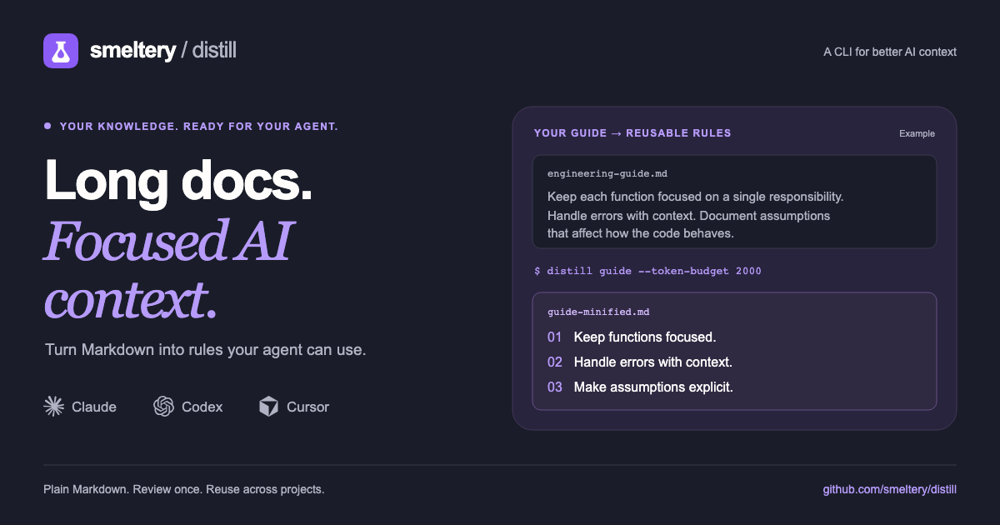

#  distill

**Less context. More clarity.** Compact local Markdown into focused knowledge for AI agents, using templates and your preferred CLI or API provider.



[](https://github.com/smeltery/distill/actions/workflows/ci.yml)
[](https://github.com/smeltery/distill/releases)
[](go.mod)
[](package.json)
[](website/)
[](.flox/env/manifest.toml)
[](LICENSE)

## Start

Install Go 1.26.9+ and authenticate the Claude CLI, or [configure another agent](docs/agents.md).

```sh
go install github.com/smeltery/distill@latest
distill config init
distill add markdown ./guide.md --name guide --template rules
distill guide
```

Read `output/guide/guide-minified.md`, review it, and share it with your agent. Templates produce rules, principles, patterns, or lightly compacted text. Claude and Codex CLIs, Anthropic, and OpenAI are supported.

Markdown ingestion works today. Other input formats, automatic publishing, and validation are not yet implemented. See [current capabilities](docs/index.md#what-works-today).

## Documentation

Start with [docs/](docs/index.md): [quick start](docs/quick-start.md), [sources](docs/sources.md), [templates](docs/templates.md), [configuration](docs/configuration.md), [commands](docs/commands.md), and [sharing context](docs/sharing.md).

For development, `flox activate` then `make setup` and `make check`. See [development](docs/development.md) for the website, CI, hooks, and release process. [SPEC.md](SPEC.md) and [PAPER.md](PAPER.md) describe the broader design; the user docs distinguish implemented behavior from planned features.

Licensed under [PolyForm Shield 1.0.0](LICENSE).
