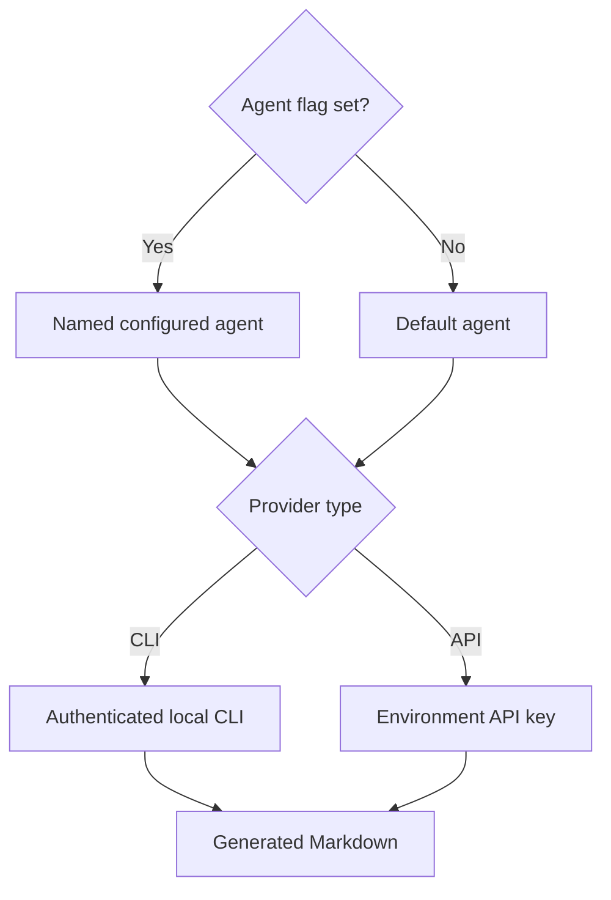

# Agents

Distill can call a locally authenticated CLI or a provider API. It sends the source and template to the selected agent.

## Choose a provider

| Provider     | Default config name | Requirement                              |
| ------------ | ------------------- | ---------------------------------------- |
| `claude-cli` | `claude-cli`        | Authenticated `claude` binary on PATH    |
| `codex-cli`  | `codex-cli`         | Authenticated `codex` binary on PATH     |
| `anthropic`  | `claude-api`        | `ANTHROPIC_API_KEY` environment variable |
| `openai`     | `gpt-api`           | `OPENAI_API_KEY` environment variable    |

```sh
distill agents
distill guide --agent codex-cli
```

`distill agents` reports configured agents and basic availability. It does not prove that a remote model or subscription is currently usable.

## Configure an API agent

Use an available model identifier for your provider account:

```yaml
default_agent: my-api
agents:
  my-api:
    provider: anthropic
    model: your-model-id
    api_key_env: ANTHROPIC_API_KEY
    max_tokens: 8192
```

Set the named environment variable in your shell or secret manager. Keep keys out of configuration files and Git. Provider requests can incur charges; local CLI calls use that CLI's account and service rules.

## Agent selection



An unknown agent, unsupported provider, missing binary, or missing API key returns an error. See [troubleshooting](troubleshooting.md).

## Use an existing CLI login

Distill invokes the configured CLI executable from your environment. Confirm the executable is available in the same shell where you run Distill:

```sh
command -v claude
command -v codex
distill agents
```

You only need the CLI you intend to use. Complete that CLI’s normal authentication before compaction, then select its configuration name:

```sh
distill guide --agent claude-cli
distill guide --agent codex-cli
```

To make Codex the project default, set `default_agent: codex-cli` in `distill.yaml`. A `--agent` flag overrides that choice for one run.

## Separate prompt size from response limits

`--token-budget` asks the model to aim for a compact result per chunk. An API agent’s `max_tokens` controls its response limit. A low response limit can cut an otherwise useful answer short; raising the prompt budget alone does not change it.

Start with a short source and inspect the result before processing a directory. Directory chunks are sent sequentially, so several files mean several provider calls. There is no local-only compaction mode: even CLI-backed agents send material through their configured service.

## Diagnose connection failures

If basic availability passes but compaction fails, inspect the reported provider error. Authentication, account access, model availability, and response limits can still fail after a binary or key is found. Run a named source so your shell receives its failure status, and see [troubleshooting](troubleshooting.md) for the next checks.
