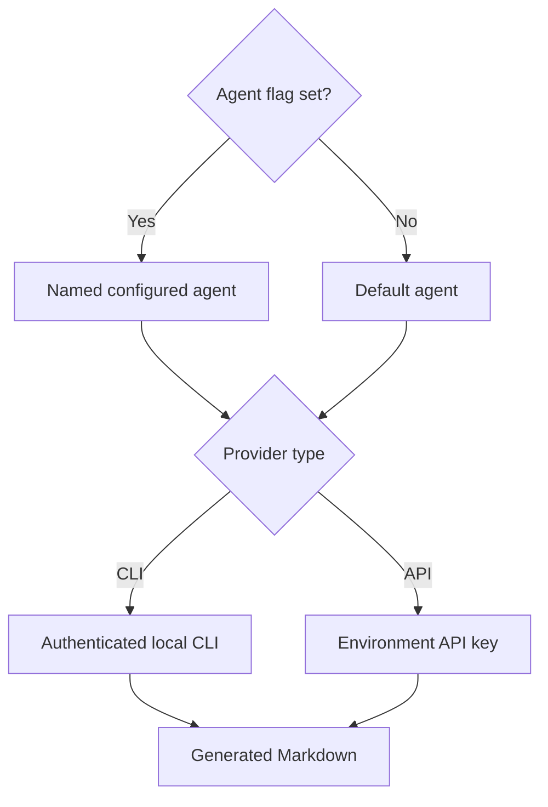

# Agents

Distill can call a locally authenticated CLI or a provider API. It sends the source and template to the selected agent.

## Choose a provider

| Provider     | Default config name | Requirement                              |
| ------------ | ------------------- | ---------------------------------------- |
| `claude-cli` | `claude-cli`        | Authenticated `claude` binary on PATH    |
| `codex-cli`  | `codex-cli`         | Authenticated `codex` binary on PATH     |
| `anthropic`  | `claude-api`        | `ANTHROPIC_API_KEY` environment variable |
| `openai`     | `gpt-api`           | `OPENAI_API_KEY` environment variable    |

```sh
distill agents
distill guide --agent codex-cli
```

`distill agents` reports configured agents and basic availability. It does not prove that a remote model or subscription is currently usable.

## Configure an API agent

Use an available model identifier for your provider account:

```yaml
default_agent: my-api
agents:
  my-api:
    provider: anthropic
    model: your-model-id
    api_key_env: ANTHROPIC_API_KEY
    max_tokens: 8192
```

Set the named environment variable in your shell or secret manager. Keep keys out of configuration files and Git. Provider requests can incur charges; local CLI calls use that CLI's account and service rules.

## Agent selection



An unknown agent, unsupported provider, missing binary, or missing API key returns an error. See [troubleshooting](troubleshooting.md).
