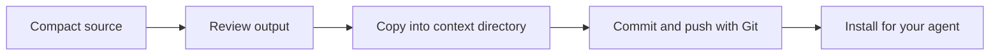

# Sharing context

Keep reviewed output in a Git repository so people and agents can reuse it.

## Create a context directory

```sh
distill init team-context
```

This creates `index.md`, `README.md`, and `.gitignore`. It does not initialize a Git repository. Add topic folders and write index entries explaining when to load each document.

## Review and publish manually



Copy the generated Markdown into the context directory, check it for errors or sensitive information, and use your usual Git review process. `distill publish` is not implemented yet.

## Install a shared repository

```sh
distill install https://github.com/your-team/context.git
```

The default target is `~/.claude/docs/`. To choose another location:

```sh
distill install https://github.com/your-team/context.git --target ./agent-context
```

When the target is already a Git repository, Distill runs `git pull` there. It does not check that the existing remote matches the requested URL. Confirm the target before reuse, and resolve local changes or conflicts with Git.

## Tell your agent what to load

Installation places files on disk; it does not automatically configure every agent to read them. Add instructions to your agent's project configuration pointing to the context index. Keep documents focused and load only the relevant sections for the task.
